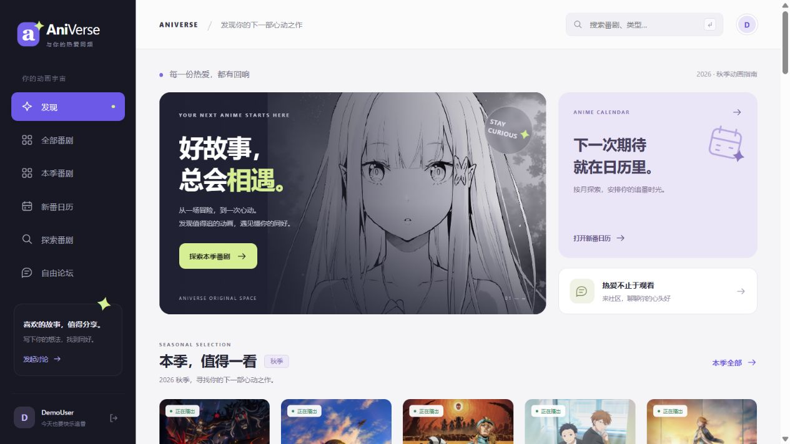
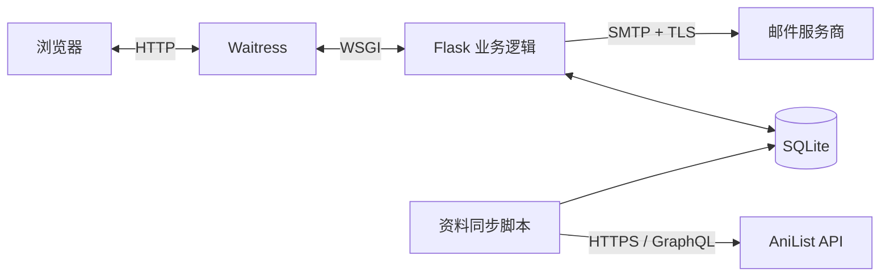

# AniVerse

一个基于 Flask 的动漫发现、评分与交流社区，也是计算机网络课程的应用层网络程序实践。

[在线站点](https://aniverse.cloud/) · [项目报告](report.md) · [PDF 报告](report.pdf) · [数据与素材说明](THIRD_PARTY_NOTICES.md)



## 功能

- 邮箱验证码注册、用户名/邮箱登录与会话管理。
- 532 部公开番剧资料，包含 200 部经典/热门作品；197 部经典作品匹配中文译名。
- 支持中文、英文、日文标题和类型检索，以及状态筛选、排序与分页。
- 评分评价、图片上传、自由论坛发帖与回复。
- 本季番剧、新番日历、北京时间显示和 B 站搜索跳转。

## 应用层网络架构



本地演示默认监听 `127.0.0.1:8080`，可在 Windows、Linux 或 macOS 上运行。公网部署可在 WSGI 服务前配置 Nginx 和 TLS。SQLite 读写服务端本地文件；浏览器通过 HTTP 访问业务功能。

## 项目结构

```text
report.md / report.pdf   项目介绍、网络流程、部署与调试记录
src/
  app.py                 HTTP 路由、认证、片库、评价与论坛
  mailer.py              TLS SMTP 验证码邮件
  sync_anime.py          AniList 数据同步
  setup_demo.py          独立演示数据初始化
  run.py                 Waitress 启动入口
  templates/             服务端渲染模板
  static/                样式、脚本与图片
  data/                  公开片库快照与经典数据
  tests/                 隔离功能测试
  deploy/                Nginx / systemd 示例
docs/                    运行截图与检查记录
```

## Windows 快速运行

建议使用 Python 3.12。解压 ZIP 后，在根目录打开 PowerShell：

```powershell
cd src
python -m venv .venv
.\.venv\Scripts\python.exe -m pip install -r requirements-lock.txt
.\.venv\Scripts\python.exe setup_demo.py
.\.venv\Scripts\python.exe run.py
```

## Linux / macOS 快速运行

```bash
cd src
python3 -m venv .venv
.venv/bin/python -m pip install -r requirements-lock.txt
.venv/bin/python setup_demo.py
.venv/bin/python run.py
```

打开 <http://127.0.0.1:8080>。演示账号为 **DemoUser**，密码为 **DemoOnly!2026**；邮箱登录名也可以使用 `demo@example.invalid`。这些是专门用于本地展示的公开测试凭据，不是线上账号。

初始化会生成随机会话密钥、SQLite 数据库、532 条公开番剧资料，以及独立的演示账号、评价、帖子和回复。已有数据时会拒绝重新初始化，不会清空数据库。普通使用直接重新运行 `run.py`，不要重复初始化。

## 验证与演示

在 `src/` 中用虚拟环境的 Python 运行：

```bash
python tests/run_tests.py
```

未激活虚拟环境时，请将 `python` 替换为上述 `.venv` 中的解释器路径。测试使用临时数据库和模拟 SMTP，不访问原服务器、不向真实地址发信。结果记录到 `docs/test-results.json`。

建议演示顺序：登录 → 全部番剧 → 搜索“进击的巨人” → 状态/评分筛选 → 详情与 B 站搜索入口 → 发布评价 → 自由论坛发帖、回复 → 新番日历。

## 邮件与数据同步

- 无需配置 SMTP 即可用演示账号登录、浏览、评价和发帖。真实注册必须自行在 `src/.env` 中配置发信账号；字段见 `.env.example`。SMTP 默认采用经过证书校验的 TLS。
- 在 `src/` 中执行 `python sync_anime.py` 可联网更新当季和未来番剧；执行 `python sync_anime.py --classics` 可更新经典片库。
- `python sync_anime.py --import-classics data/classics-anilist.json` 可重复导入随包的公开经典数据，不需联网。按 MAL ID 更新并保留站内记录 ID、用户评价及经典标记。
- 本地 CSS、JS 和首页插画已包含；番剧封面是外部图片 URL，封面加载及在线同步需要网络。离线可浏览已初始化的文字资料和使用论坛。

## 版本与验证

本仓库基于 2026-10-22 的运行源码和公开片库快照，包含 2026-10-23 整理的课程报告。为独立复现新增了演示初始化、运行入口、锁定依赖和测试，并在 `app.py` 中增加数据库、上传目录的环境变量配置。

随附验证记录为当时的实际运行结果：36 项隔离自动测试通过，20 项本地 TCP/HTTP 检查通过；手机端检查覆盖 390 px 和 320 px。详见 [功能检查](docs/test-results.json)、[HTTP 复现检查](docs/reproduction-check.json) 和 [浏览器检查](docs/browser-check.json)。

仓库不含生产 `.env`、线上用户数据库、用户上传图片或服务器凭据。演示账号和社区内容由初始化脚本独立生成。真实邮件注册需要运行者配置自己的 SMTP 账号，字段见 `src/.env.example`。

## 数据与素材

番剧资料来自 AniList，中文译名来自 bangumi-data（CC BY 4.0）；项目页脚和随附说明保留署名。第三方图片、数据和依赖的说明见 [THIRD_PARTY_NOTICES.md](THIRD_PARTY_NOTICES.md)。
