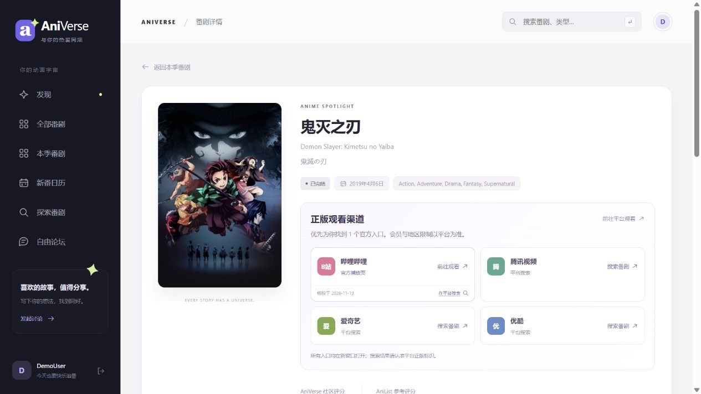

# 正版观看渠道（2026-11-13）

番剧详情新增观看渠道区域。已核验的官方播放页优先展示；仅能确认官方番剧介绍页时，按钮明确标为“官方番剧页”。未配置或未通过校验的作品，显示哔哩哔哩、腾讯视频、爱奇艺、优酷的平台搜索入口。搜索优先使用中文标题，随后使用英文或日文标题；中文与特殊字符均进行 URL 编码。

官方入口也保留“在平台搜索”备用按钮，以应对页面迁移、会员或地区限制。所有入口在新窗口打开，携带 `noopener noreferrer`。搜索结果可能含用户上传内容，请认准平台正版标识；页面可访问不等于所有地区、所有用户都能免费播放。

## 当前覆盖

首批 12 部作品，按精确 MyAnimeList ID 匹配，避免不同季度、前后半部或重制版串用链接。其他作品均可使用四个平台搜索入口。



浏览器检查使用独立演示数据，覆盖有官方入口、仅搜索入口、非 B 站官方入口优先三种情况；390 px 和 320 px 窄屏均无横向溢出，评分与评价表单仍正常显示。

| 作品 | MAL ID | 平台 | 入口类型 |
| --- | --- | --- | --- |
| 鬼灭之刃 | 38000 | 哔哩哔哩 | 官方播放页 |
| 咒术回战 | 40748 | 哔哩哔哩 | 官方播放页 |
| 刀剑神域 | 11757 | 哔哩哔哩 | 官方番剧页 |
| 四月是你的谎言 | 23273 | 哔哩哔哩 | 官方播放页 |
| 灵能百分百 | 32182 | 哔哩哔哩 | 官方播放页 |
| 全职猎人（2011） | 11061 | 爱奇艺 | 官方播放页 |
| Re:0 第二季前半 | 39587 | 哔哩哔哩 | 官方播放页 |
| Re:0 第二季后半 | 42203 | 哔哩哔哩 | 官方播放页 |
| 间谍过家家（2022 前半） | 50265 | 哔哩哔哩 | 官方播放页 |
| 紫罗兰永恒花园 | 33352 | 哔哩哔哩 | 官方播放页 |
| Dr.STONE 石纪元 | 38691 | 哔哩哔哩 | 官方番剧页 |
| 堀与宫村 | 42897 | 哔哩哔哩 | 官方番剧页 |

完整目标 URL、核验日期和依据保存在 [配置文件](../src/data/watch_channels.json)。所列日期是页面核验日期，不是平台版权期限保证。

## 实现与维护

`app.py` 在渲染详情页时调用 `watch_channels.build_watch_channels()`，将官方入口与搜索入口交给 `templates/watch_channels.html`。配置只从本地 JSON 读取并按进程缓存；正常浏览不新增第三方请求，也不需要修改数据库或配置平台 API 密钥。

维护时在 `src/data/watch_channels.json` 的 `entries` 中，以作品精确 MAL ID 为键添加记录：

```json
"38000": [{
  "platform": "bilibili",
  "url": "https://www.bilibili.com/bangumi/play/ss26801",
  "verified_title": "鬼灭之刃",
  "verified_on": "2026-11-13",
  "evidence_url": "https://www.bilibili.com/bangumi/media/md22718131/"
}]
```

1. 从官方平台页面核对作品、季别、年份与页面类型；不要根据相似标题猜地址，也不要将第一季的链接复制给后续季。
2. `platform` 支持 `bilibili`、`tencent`、`iqiyi`、`youku`。只接受 HTTPS 的白名单域名和番剧/播放器页面路径；拒绝用户投稿页、原始视频流和任意外部重定向参数。
3. `verified_on` 填实际复核日期。未来日期、超过 180 天的日期、无效字段或 `enabled: false` 均自动退回平台搜索。发现下架或错误时应立即禁用，180 天规则只是避免长期保留无人维护的入口。
4. 保存配置后重新启动本地应用；生产 Gunicorn 需平滑重载工作进程，清除进程内配置缓存。JSON 缺失或损坏时，详情页仍提供平台搜索。
5. 运行 `python tests/run_tests.py`。观看渠道的 16 项检查连同原有 36 项检查，使用隔离数据库与模拟邮件，不访问真实播放平台；首次加入实际 URL 仍须人工核验。

本功能仅提供官方页面导航与平台搜索，不抓取、代理或存储视频。数据来源与许可见 [第三方说明](../THIRD_PARTY_NOTICES.md)。
