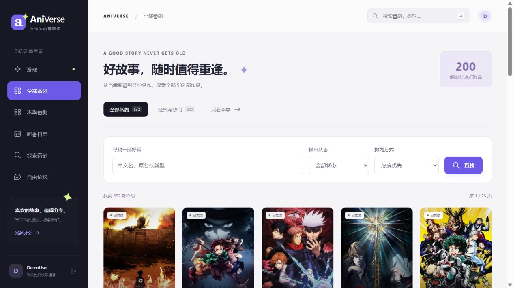
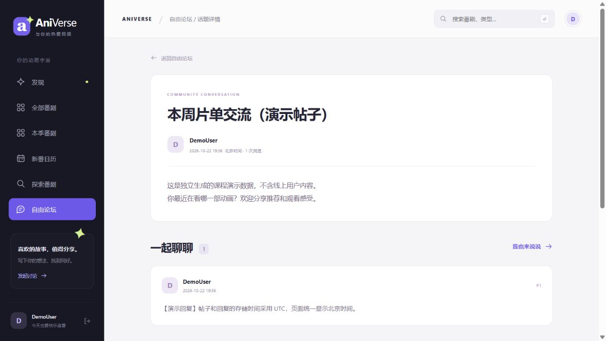

# AniVerse

**动漫发现与交流社区 | 应用层网络程序课程报告**

整理日期：2026-10-23；运行源码与公开片库快照：2026-10-22。

## 1. 项目简介

AniVerse 是一个基于浏览器/服务器架构的 Web 应用，将番剧检索、评分评价和社区讨论集中在同一站点。它通过 HTTP 处理页面与表单，通过 SMTP 发送注册验证码，并通过 HTTPS GraphQL 请求同步番剧资料。线上展示地址为 https://aniverse.cloud/；本提交包可在独立电脑运行，无需连接原服务器。

| 功能 | 实现内容 |
| --- | --- |
| 账号 | 邮箱验证码注册、用户名/邮箱登录、会话与退出登录 |
| 片库 | 532 部公开作品；200 部经典/热门作品，197 条匹配中文译名 |
| 发现 | 中英日文及类型搜索、状态筛选、热度/评分/时间排序与分页 |
| 交流 | 1-10 分评价、可选图片上传、论坛发帖、回复与浏览量 |
| 辅助 | 本季番剧、新番日历、北京时间显示、B 站站内搜索跳转 |

## 2. 网络架构

```text
Browser -- HTTP / HTTPS --> [Nginx] --> Waitress / Flask
                                          |
                    +---------------------+------------------+
                    |                     |                  |
                 SQLite              SMTP + TLS      sync_anime.py
                 local DB             mail provider     |
                                                     HTTPS GraphQL
                                                         |
                                                      AniList API
```

本地演示使用 Waitress + Flask，默认监听 127.0.0.1:8080。公网部署可在前面配置 Nginx 与 TLS。SQLite 是服务端本地持久化数据库，不对浏览器开放数据库端口。

核心模块：`app.py` 负责 HTTP 路由与数据操作；`mailer.py` 负责 SMTP；`sync_anime.py` 负责远程数据同步；`templates/` 和 `static/` 提供界面。

## 3. 独立部署与运行

建议 Python 3.12。以下命令均从解压后的作业根目录执行。安装依赖需要访问包仓库；首次初始化直接读取随包数据，不依赖在线 API。

### Windows PowerShell

```text
cd src
python -m venv .venv
.\.venv\Scripts\python.exe -m pip install -r requirements-lock.txt
.\.venv\Scripts\python.exe setup_demo.py
.\.venv\Scripts\python.exe run.py
```

### Linux / macOS

```text
cd src
python3 -m venv .venv
.venv/bin/python -m pip install -r requirements-lock.txt
.venv/bin/python setup_demo.py
.venv/bin/python run.py
```

浏览器打开 `http://127.0.0.1:8080`，使用 **DemoUser / DemoOnly!2026** 登录。也可用 `demo@example.invalid` 作为登录名。该账号仅用于本地课程展示。

`setup_demo.py` 自动生成随机会话密钥和独立数据库，导入 532 条公开番剧资料，并生成演示评价、帖子与回复。检测到已有数据时拒绝重新初始化。再次使用时只运行 `run.py`；端口冲突可加 `--port 8081`。

### 邮件与同步配置

用演示账号浏览、评价和发帖无需发信配置。真实注册需参照 `.env.example` 在本地 `.env` 填写 SMTP 账号与授权码。支持 SSL 465 或 STARTTLS 587，并验证服务器证书；QQ 邮箱使用 SMTP 授权码而非网页登录密码。

```text
python sync_anime.py
python sync_anime.py --classics
python sync_anime.py --import-classics data/classics-anilist.json
```

以上三条分别用于在线更新当季/未来番剧、在线更新经典片库、导入随包经典数据。运行时应使用虚拟环境的 Python。Linux 服务与 Nginx 示例见 `src/deploy/`，需按实际路径、运行用户、域名及证书修改。

## 4. 应用层通信与实现

### HTTP 接口与数据格式

| 方法与路径 | 用途 / 请求及响应 |
| --- | --- |
| GET /、POST /login | 显示登录页；接收表单，成功后 302 跳转并设置会话 Cookie |
| POST /auth/send-code | 接收 JSON 邮箱；返回 JSON，使用 200/400/409/429/503 区分结果 |
| POST /register | 接收用户名、邮箱、验证码和密码；校验后创建用户 |
| GET /library、/search | 使用查询参数检索、筛选、排序；返回服务端渲染的 HTML |
| GET /season、/calendar | 展示本季及按月首播资料 |
| GET/POST /anime/<id> | 读取详情；以 multipart/form-data 提交评分、文字与图片 |
| GET/POST /forum/new | 显示发帖表单或提交帖子 |
| GET/POST /forum/post/<id> | 读取帖子/回复，或向同一路径提交回复 |

### 验证码邮件流程

浏览器发送邮箱 → 服务端校验格式、已注册状态及冷却时间 → 短事务取得该邮箱的发送锁 → 释放数据库连接后通过 TLS SMTP 发信 → 邮件服务器接受后保存验证码哈希与有效期 → 返回 JSON。注册时再验证哈希、到期时间和尝试次数，成功后删除验证码。

验证码有效期为 5 分钟，重发冷却为 60 秒。同一邮箱并发请求只能有一个发送者；失败会释放发送锁，并保留先前有效验证码。邮件为文本/HTML 双格式，带 Date 与 Message-ID。日志保留阶段、状态码和收件域名，不记录验证码、密码或完整收件地址。

### 数据、会话与时间

SQLite 表包括 users、anime、reviews、forum_posts、forum_replies、email_codes 与 email_send_locks。密码与验证码使用 Werkzeug 哈希；SQL 查询采用参数绑定，排序字段使用白名单。Flask 会话使用签名 Cookie，并配置 HttpOnly 与 SameSite=Lax；签名不等于加密。

帖子与回复以 UTC 存储，仅在模板层转换成北京时间（UTC+8），避免直接改写历史时间。资料同步以精确 MAL ID 更新，保留站内作品 ID 和关联评价；已有人工中文译名及经典标记不会被普通同步覆盖。

## 5. 实际运行截图

以下截图均来自本提交包在本地运行的演示账号，不含线上用户内容。完整登录页、首页和其他截图见 `docs/screenshots/`。



图 1：全部片库及搜索、筛选、排序入口；初始化后共 532 部作品。




图 2（左）：论坛帖子与回复，页面明确显示北京时间。图 3（右）：390 px 手机片库；另检查了 320 px 窄屏，没有水平溢出，检查期间控制台未发现错误。

## 6. 测试与调试记录

在 Python 3.12.14 / Windows 环境运行随包测试，**36 项全部通过**，失败和错误均为 0，耗时约 15.0 秒。记录见 `docs/test-results.json`。测试使用临时数据库和模拟 SMTP，不触碰线上数据，不实际发信。

```text
cd src
python tests/run_tests.py
```

| 调试问题 | 原因与处理 |
| --- | --- |
| 论坛显示慢 8 小时 | SQLite 默认时间为 UTC。增加统一展示过滤器，并验证跨日及带时区输入，历史存储值保持原样。 |
| 邮件偶发失败难定位 | 增加阶段化日志、发送锁及连接阶段有限重试；认证 535 不重试，发送结果不确定时避免自动重复投递。 |
| QUIT 报错误判发送失败 | 服务器已接受邮件后，关闭连接失败不能撤销投递。将清理异常与发送结果分开处理。 |
| 经典导入与评价关联 | 按 MAL ID 执行更新而非替换记录；重复导入两次，验证站内 ID、条数和原有演示评价均保留。 |

开发期间另完成过一封经授权的真实邮件投递测试，并收到收件箱实收确认；随包不包含该地址、发信密钥或生产数据库。材料提供的是实际界面与检查记录，不补造成员分工或协作照片。

### 当前范围与后续改进

番剧封面为外部 URL，封面显示和在线同步受网络影响；随包快照支持离线文字浏览。系统提供评论社区与合法平台搜索跳转，不提供视频托管或播放。进一步可补充 CSRF 防护、图片内容校验、IP 级限流、后台任务队列与更大规模数据库部署。

### 资料来源与工具

元数据来自 AniList；中文译名来自 bangumi-data，按精确 MAL ID 筛选并依 CC BY 4.0 署名。现有插画及动画封面权利归相应权利人。开发与材料整理使用过 AI 辅助编程。详情见 `THIRD_PARTY_NOTICES.md`。

- [Flask / Waitress 部署](https://flask.palletsprojects.com/en/stable/deploying/waitress/)
- [Python smtplib](https://docs.python.org/3/library/smtplib.html)
- [AniList GraphQL](https://docs.anilist.co/guide/graphql/)
- [bangumi-data 与许可](https://github.com/bangumi-data/bangumi-data)
